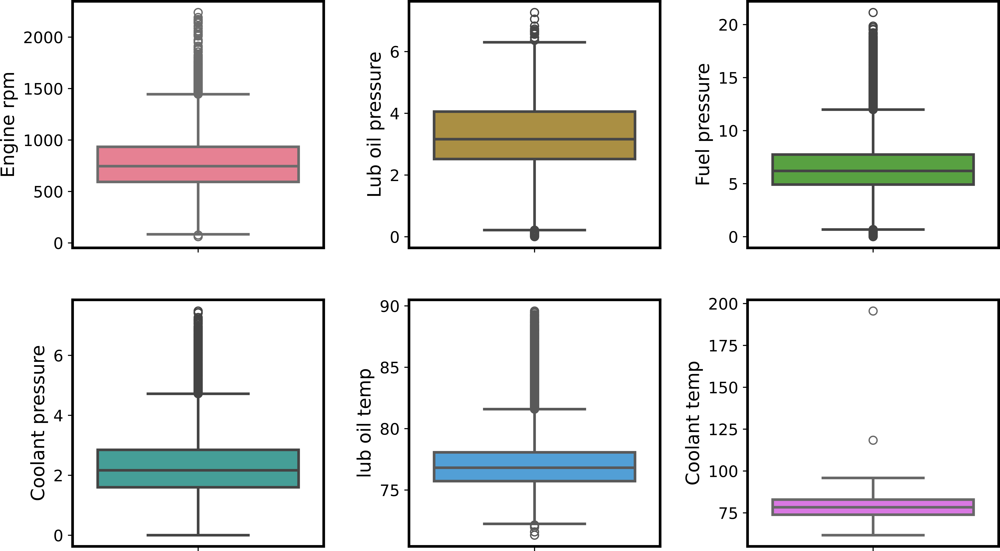
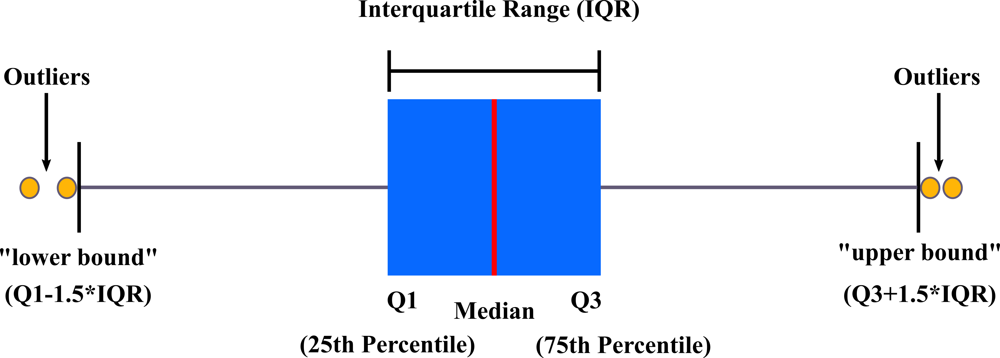
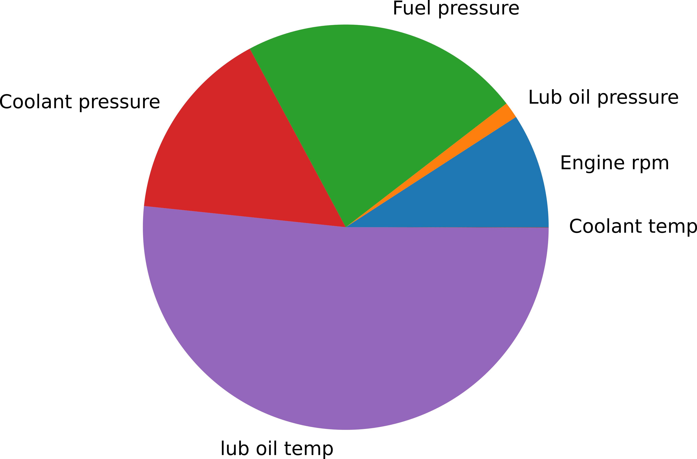

# **Detecting Anomalous Activity of a Ship's Engine**

  
## **Objectives**

To understand and apply statistical and machine learning (ML) methods for detecting anomalies, where the project:

* explores the data set
* preprocesses the data and conducts feature engineering
* applies statistical techniques to detect anomalies
* uses ML algorithms to detect anomalies.
  
## **Business Context**

Creating a reliable anomaly detection system that assesses engine performance is one 
way to mitigate potential safety hazards and significant downtime that can arise from a 
poorly maintained ship engine. The current study analyses a dataset containing six 
distinct features considered critical to the performance of a ship’s engine. 

## **Methods**

The anomaly detection is initially performed using  a statistical approach incorporating 
the interquartile range (IQR) , followed by two unsupervised ML models, namely One-Class 
Support Vector Machine (SVM) and Isolation Forest. The results obtained from the two ML techniques 
are visualised using a dimensionality reduction technique called the Principal Component Analysis (PCA).

## **EDA- Outliers Visualised per Feature**

The colour-coded  box plots produced  for each feature considered critical for engine 
performance:

  

  

  

## **The IQR Approach**

The principle behind the IQR approach is depicted in the figure below where upper and lower 
bounds are derived per feature and used to flag outliers in a row-wise fashion:

  

  

  

The total flag count obtained for each feature is represented as a percentage of the total 
number of datapoints in the figure below:  

  

  

  

The highest percentage of outliers is obtained for ‘lubricant oil temperature’ at 13.4% and the lowest 
percentage of outliers is obtained for ‘coolant temperature’ at 0.01%. But the sole presence of an outlier 
for a given feature does not indicate an anomaly in the engine’s status. Therefore, outlier percentage 
was re-assessed by counting the instances of outliers per data entry. The results indicate, the total 
percentage of samples identified as outliers falls within the expected 1-5% range only when two features 
are simultaneously flagged.  

## **The SVM Approach**
One-class SVM maps the input data into a hyperplane by employing a kernel function 
such that most of the normal observations end up separated from the origin and 
enclosed within the decision boundary. The model was run using a radial kernel function 
and with various combinations of the tuning parameters gamma and nu. The key results 
are highlighted in the table below:

While a lower gamma implies a broader decision boundary, a lower nu decreases the 
likelihood of including more points within the boundary which collectively reduces the 
sensitivity to outliers. The post model-tuning, PCA visualisations are presented in 
panel A of the figure below.

## **The Isolation Forest Approach**
Isolation Forest is an ensemble method that treats anomalies as exceptions, thereby 
isolating them in fewer partitions of a decision tree. The model has two tuneable 
parameters, number of estimators which specifies the number of decision trees and 
contamination which controls the expected ratio of anomalies to normal datapoints. 
Since by setting contamination, one can directly tune the anomaly percentage, the model 
was run with contamination set to 0.05, 0.03 and 0.01 respectively, while the number of 
estimators was fixed to 100. Panel B of the figure below shows the model predictions 
projected on to the previously computed principal axes (PC1 and PC2).

## **Combined ML Results**
The results predicted using the one-class SVM technique are shown in panel A whereas 
those predicted using the Isolation Forest technique are shown in panel B. 

  

  

  

In both cases, the model outputs are presented in a descending order of anomaly percentage. 
The red arrows added to the Isolation Forest output point to outermost points where the datapoints 
contrast the anomaly predictions made by one-class SVM. 

## **Summary & Conclusions** 

The IQR approach indicated only when two features were simultaneously flagged as 
outliers that the expected outlier threshold was satisfied and an anomalous status could 
be assumed for the ship’s engine. Despite producing realistic results, the IQR approach 
is a tedious process that can prove problematic for high-dimensional data. 

Both the one-class SVM and the Isolation Forest methods proved highly effective in 
dealing with a multi-dimensional dataset. The 2D plots show the density of anomalous 
datapoints decreases while their resolution increases as each model is tuned towards 
a lower anomaly percentage. 

The two components, PC1 and PC2, account for roughly 37% of the variance of a 
multivariate dataset and perform poorly in segmenting/clustering the anomalous and normal datapoints. 
However, even when the anomaly percentage is reduced to the 1% range, the densest portion 
of the anomalous datapoints remains centralised which could be indicative of a 
pattern in real space.  

When comparing the two ML models, the PCA plots differ slightly. Most notably, a 
datapoint situated furthest along  PC1 is persistently classified as an anomaly by one-
class SVM while being simultaneously classified as normal by Isolation Forest. At the 1% 
anomaly rate, the differences in classification become more frequent and apparent, 
especially across the upper-left segment. Given the points marked by the red arrows
are located at the extremes of the principal axes, the one-class SVM approach 
can be said to produce more accurate anomaly predictions, albeit at a computational 
cost. 

